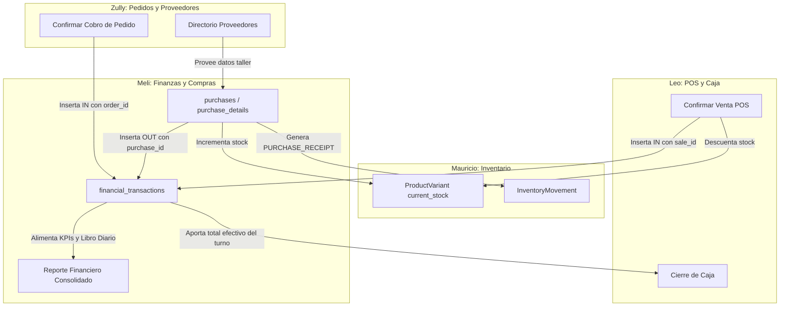

# Módulo de Finanzas, Compras y Reposiciones — Registro de Cambios e Integración

> **Responsable:** Melissa  
> **Tablas asignadas:** `purchases`, `purchase_details`, `financial_transactions`    
> **Estado:** Implementado, probado con 9 tests unitarios/integración en verde y compatible con el frontend existente.

---

## 1. Alcance y Responsabilidad de Meli

Conforme al acuerdo de distribución del equipo:
- **Meli asume Compras, Reposiciones y Movimientos Financieros**, ya que las compras a talleres y confeccionistas se relacionan de forma directa con los costos de adquisición y los flujos monetarios de salida.
- Mantiene la propiedad, restricciones y modelos de las 3 tablas asignadas sin modificar unilateralmente tablas ni columnas pertenecientes a Keila, Mauricio, Leo o Zully.

---

## 2. Cambios Realizados en el Proyecto

### 2.1. Backend (Spring Boot 3.4 / Java 25)

Siguiendo la arquitectura establecida en [`CONVENCIONES_BACKEND.md`](./CONVENCIONES_BACKEND.md):

#### A. Repositorios Spring Data JPA (`infrastructure/persistence/`)
- [`PurchaseRepository.java`](file:///c:/Users/Melissa%20Maibi/Desktop/Proyectos/proyecto-prisma/backend/src/main/java/com/prisma/api/infrastructure/persistence/PurchaseRepository.java): Historial de compras ordenadas cronológicamente y búsqueda por proveedor.
- [`PurchaseDetailRepository.java`](file:///c:/Users/Melissa%20Maibi/Desktop/Proyectos/proyecto-prisma/backend/src/main/java/com/prisma/api/infrastructure/persistence/PurchaseDetailRepository.java): Consulta de líneas de productos/variantes compradas por lote.
- [`FinancialTransactionRepository.java`](file:///c:/Users/Melissa%20Maibi/Desktop/Proyectos/proyecto-prisma/backend/src/main/java/com/prisma/api/infrastructure/persistence/FinancialTransactionRepository.java): Búsqueda polimórfica de transacciones entre fechas (UTC), por estado y orígenes (`sale_id`, `order_id`, `purchase_id`).
- **Repositorios de enlace:**
  - [`SupplierRepository.java`](file:///c:/Users/Melissa%20Maibi/Desktop/Proyectos/proyecto-prisma/backend/src/main/java/com/prisma/api/infrastructure/persistence/SupplierRepository.java): Validación de existencia y estado activo de proveedores.
  - [`ProductVariantRepository.java`](file:///c:/Users/Melissa%20Maibi/Desktop/Proyectos/proyecto-prisma/backend/src/main/java/com/prisma/api/infrastructure/persistence/ProductVariantRepository.java): Consulta y actualización de stock y costo de variantes.
  - [`InventoryMovementRepository.java`](file:///c:/Users/Melissa%20Maibi/Desktop/Proyectos/proyecto-prisma/backend/src/main/java/com/prisma/api/infrastructure/persistence/InventoryMovementRepository.java): Registro inmutable en el Kardex físico.
  - [`CashRegisterRepository.java`](file:///c:/Users/Melissa%20Maibi/Desktop/Proyectos/proyecto-prisma/backend/src/main/java/com/prisma/api/infrastructure/persistence/CashRegisterRepository.java): Vinculación de egresos/ingresos en efectivo al turno de caja abierto.

#### B. DTOs Records inmutables y Mappers (`application/`)
- **Compras (`application/purchase/`):**
  - [`CreatePurchaseRequest.java`](file:///c:/Users/Melissa%20Maibi/Desktop/Proyectos/proyecto-prisma/backend/src/main/java/com/prisma/api/application/purchase/dto/CreatePurchaseRequest.java): DTO de entrada con `@Valid` (proveedor obligatorio, cantidad $> 0$, costo unitario $\ge 0$). Admite tanto `variantId` directo como `productId` para máxima compatibilidad con el modal de reposición.
  - [`PurchaseDetailResponse.java`](file:///c:/Users/Melissa%20Maibi/Desktop/Proyectos/proyecto-prisma/backend/src/main/java/com/prisma/api/application/purchase/dto/PurchaseDetailResponse.java) y [`PurchaseResponse.java`](file:///c:/Users/Melissa%20Maibi/Desktop/Proyectos/proyecto-prisma/backend/src/main/java/com/prisma/api/application/purchase/dto/PurchaseResponse.java): DTOs de salida con importes redondeados y nombres enriquecidos.
  - [`PurchaseMapper.java`](file:///c:/Users/Melissa%20Maibi/Desktop/Proyectos/proyecto-prisma/backend/src/main/java/com/prisma/api/application/purchase/mapper/PurchaseMapper.java): Mapper desacoplado que evita exponer entidades JPA en controladores.
- **Finanzas (`application/finance/`):**
  - [`FinancialSummaryResponse.java`](file:///c:/Users/Melissa%20Maibi/Desktop/Proyectos/proyecto-prisma/backend/src/main/java/com/prisma/api/application/finance/dto/FinancialSummaryResponse.java): Contiene `period`, `totalPhysicalSales`, `totalOnlineSales`, `totalRevenue`, `totalCostOfGoodsSold`, `grossProfit`, `netMarginPercentage` y la lista de `transactions`.
  - [`FinancialTransactionResponse.java`](file:///c:/Users/Melissa%20Maibi/Desktop/Proyectos/proyecto-prisma/backend/src/main/java/com/prisma/api/application/finance/dto/FinancialTransactionResponse.java): Representación normalizada para el libro diario en frontend.
  - [`FinancialTransactionMapper.java`](file:///c:/Users/Melissa%20Maibi/Desktop/Proyectos/proyecto-prisma/backend/src/main/java/com/prisma/api/application/finance/mapper/FinancialTransactionMapper.java): Deduce automáticamente el canal (`Presencial (POS)`, `Online (WhatsApp)`, `Compra Proveedor`), categoría contable y descripción según las relaciones activas.

#### C. Lógica Transaccional de Servicios (`application/`)
- [`PurchaseService.java`](file:///c:/Users/Melissa%20Maibi/Desktop/Proyectos/proyecto-prisma/backend/src/main/java/com/prisma/api/application/purchase/PurchaseService.java):
  - **Transacción atómica unificada:** En una sola operación `@Transactional`:
    1. Valida el proveedor y la variante activa.
    2. Registra la compra (`purchases`) con `status = 'RECEIVED'`.
    3. Registra el detalle (`purchase_details`) con costo unitario de compra exacto.
    4. Incrementa el stock real (`ProductVariant.current_stock`) y actualiza el último `cost_price`.
    5. Registra el movimiento en el Kardex (`InventoryMovement` con `PURCHASE_RECEIPT` y `quantity > 0`).
    6. Registra el egreso financiero en `financial_transactions` (`OUT`, `VERIFIED`, importe total = `quantity * unitCost`).
    7. Valida la regla RN08/RN09: si el medio de pago es `EFECTIVO`, exige que exista un turno de caja abierto y le asocia `cash_register_id`, cumpliendo la restricción `ck_financial_cash_requires_register`.
- [`FinancialService.java`](file:///c:/Users/Melissa%20Maibi/Desktop/Proyectos/proyecto-prisma/backend/src/main/java/com/prisma/api/application/finance/FinancialService.java):
  - Procesa los rangos de fechas en UTC sin desajustes por zona horaria.
  - Filtra estrictamente transacciones en estado `VERIFIED` para métricas contables.
  - Calcula ventas físicas, ventas online, costo de mercadería, utilidad bruta y margen porcentual.

#### D. Controladores REST (`infrastructure/web/`)
- [`PurchaseController.java`](file:///c:/Users/Melissa%20Maibi/Desktop/Proyectos/proyecto-prisma/backend/src/main/java/com/prisma/api/infrastructure/web/PurchaseController.java):
  - `POST /api/purchases`: Registro y recepción de compras (HTTP 201).
  - `GET /api/purchases`: Historial general de reposiciones (HTTP 200).
  - `GET /api/purchases/{id}`: Detalle completo de una compra (HTTP 200).
- [`FinancialController.java`](file:///c:/Users/Melissa%20Maibi/Desktop/Proyectos/proyecto-prisma/backend/src/main/java/com/prisma/api/infrastructure/web/FinancialController.java):
  - `GET /api/finance/summary?startDate={}&endDate={}`: Resumen consolidado y KPIs (HTTP 200).
  - `GET /api/finance/transactions?type={}&startDate={}&endDate={}`: Libro diario filtrable (HTTP 200).
  - `POST /api/finance/transactions`: Registro de movimientos manuales extraordinarios (HTTP 201).

---

### 2.2. Frontend (React 19 / Vite)

- [`financialService.js`](file:///c:/Users/Melissa%20Maibi/Desktop/Proyectos/proyecto-prisma/frontend/src/feature/financial-reports/services/financialService.js):
  - Conectado a `GET /api/finance/summary` mediante `apiClient`.
  - Diseñado con fallback seguro: si el backend está activo entrega los datos en tiempo real; si está apagado conmuta sin errores a los datos de prueba locales.
- [`suppliersService.js`](file:///c:/Users/Melissa%20Maibi/Desktop/Proyectos/proyecto-prisma/frontend/src/feature/suppliers/services/suppliersService.js):
  - `registerRestock()` conectado a `POST /api/purchases` con fallback seguro para persistencia real de mercadería.

---

## 3. Matriz de Entrelazamiento e Integración con el Equipo

El siguiente cuadro detalla cómo el trabajo de cada compañero alimenta directamente este módulo sin generar colisiones ni exigir modificaciones a futuro:

### Detalle por Integrante:

| Integrante | Módulo / Tablas | ¿Cómo se entrelaza con Meli? | Acción técnica de integración |
|---|---|---|---|
| **Leo** | **POS & Caja** `sales`, `cash_registers`, `sale_returns` | **Ventas presenciales y cierre de caja.** Cada venta cobrada en mostrador debe alimentar el ingreso del reporte financiero. Al cerrar caja, Leo necesita los cobros verificados del turno. | Al confirmar una venta en `SaleService`, Leo inserta una fila en `financial_transactions` con `sale_id`, `transaction_type = 'IN'` y `status = 'VERIFIED'`. Tu línea `if (tx.getSale() != null)` la sumará inmediatamente en **Ventas Físicas (POS)** sin tocar tu código. |
| **Zully** | **Pedidos & Proveedores** `orders`, `suppliers` | **Ventas online y talleres.** Los pedidos por redes cobrados deben alimentar las ventas online. El registro de reposiciones necesita los talleres registrados por Zully. | Cuando Zully valide el pago de un pedido (ej. Yape/Plin), insertará en `financial_transactions` con `order_id` y `transaction_type = 'IN'`. Tu línea `else if (tx.getOrder() != null)` la computará en **Ventas Online**. Meli consume `SupplierRepository` de Zully para validar compras. |
| **Mauricio** | **Inventario & Kardex** `product_variants`, `inventory_movements` | **Stock disponible y valorización de inventario.** Las compras de Meli abastecen el inventario físico que venden Leo y Zully. | Al registrar una reposición en `PurchaseService`, Meli incrementa `ProductVariant.current_stock` y registra la entrada inmutable en `inventory_movements` (`PURCHASE_RECEIPT` con `quantity > 0` y `purchase_detail_id`). Las ventas de Leo descuentan de ese mismo stock. |
| **Keila** | **Seguridad & Dashboard** `users`, JWT, RBAC | **Auditoría de autor y seguridad.** Toda compra y transacción debe saber qué personal la autorizó (`created_by`, `recorded_by`). | Meli inyecta `CurrentUserProvider` para obtener automáticamente el `User` autenticado sin depender de código manual. Las rutas de finanzas quedan protegidas con JWT para rol `ADMIN`. |

---

## 4. Garantías y Reglas de Base de Datos Cumplidas

1. **Aritmética Monetaria Exacta:**
   - Montos de transacciones financieras en `numeric(12,2)` usando `BigDecimal` con `RoundingMode.HALF_UP`.
   - Costos unitarios de compra en `numeric(14,4)` para no perder precisión en prorrateos de confección.
2. **Restricción de Origen Único (`ck_financial_single_origin`):**
   - Toda transacción financiera tiene como máximo un único origen no nulo entre `sale_id`, `order_id`, `purchase_id` y `sale_return_id`.
3. **Restricción de Dirección (`ck_financial_direction_purchase`):**
   - Si `purchase_id` está presente, la transacción es estrictamente de salida (`OUT`).
4. **Verificación Contable (`ck_financial_verification`):**
   - Los registros en estado `VERIFIED` cuentan obligatoriamente con `verified_by` y `verified_at` no nulos.
5. **Efectivo y Turno de Caja (`ck_financial_cash_requires_register`):**
   - Ningún pago en efectivo verificado se guarda sin `cash_register_id`.
6. **Inmutabilidad de Migraciones:**
   - No se modificó ningún archivo en `db/migration/`. El esquema `V1__esquema_inicial.sql` y `V2__datos_iniciales.sql` se respetan de forma intacta.
7. **Política de Control de Versiones:**
   - **No se realizó ningún `git push`.** Todos los cambios se mantienen en local para la revisión y aprobación correspondiente de Zully mediante Pull Request.
